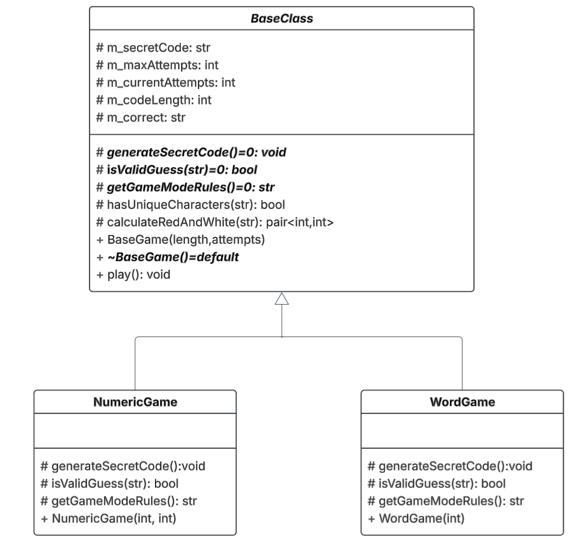

# Mastermind Game

## Background
<ul>
<li>Numeric Mode: The computer generates a secret non-repeating 4-digit number code.</li>
<li>Word Mode: The computer generate a secret 5 letter isogram (non-repeating letters) word.</li>
<li>The player is trying to guess the code in a specified number of attempts (default 10).</li>
<li>After the player guesses, the computer will provide feedback indicating how many digits/letters in the guess matched the same digit/letters and position in the secret code ('reds') and how many digits/letters matched digits in the secret code, but are not in the matching position ('whites').</li>
</ul>

## Interface Prototype Examples

### Test Case Numeric Mode
<pre><b>Select Game Mode:
1. Number Mode (4 digits)
2. Word Mode (6 letters)
Choice: 1

--- Starting Game ---
Mode: Numbers. Guess a 4-digit number with unique digits (0-9).
You have 10 attempts.

Attempt 1/10 - Enter guess: 9876
Correct ->9xxx
Result: 1 Red(s), 2 White(s)

Attempt 2/10 - Enter guess: 9768
Correct ->97xx
Result: 2 Red(s), 1 White(s)

Attempt 3/10 - Enter guess: 9786
Correct ->978x
Result: 3 Red(s), 0 White(s)

Attempt 4/10 - Enter guess: 9780
Correct ->978x
Result: 3 Red(s), 0 White(s)

Attempt 5/10 - Enter guess: 1234
Correct ->978x
Result: 0 Red(s), 1 White(s)

Attempt 6/10 - Enter guess: 9781
Correct ->978x
Result: 3 Red(s), 0 White(s)

Attempt 7/10 - Enter guess: 9782

Congratulations! You guessed the secret code: 9782</b></pre>

### Test Case Word Mode
<pre><b>Select Game Mode:
1. Number Mode (4 digits)
2. Word Mode (6 letters)
Choice: 2

--- Starting Game ---
Mode: Word Isogram. Guess a 5-letter lowercase word with no repeating letters.
You have 10 attempts.

Attempt 1/10 - Enter guess: stare
Correct ->xxaxx
Result: 1 Red(s), 2 White(s)

Attempt 2/10 - Enter guess: peach
Correct ->xxaxx
Result: 1 Red(s), 1 White(s)

Attempt 3/10 - Enter guess: heart
Correct ->xxaxt
Result: 2 Red(s), 0 White(s)

Attempt 4/10 - Enter guess: blast
Correct ->xxast
Result: 3 Red(s), 0 White(s)

Attempt 5/10 - Enter guess: coast

Congratulations! You guessed the secret code: coast</b></pre>

## Directions
<ul>
<li>Fork the Test2-MasterMind-Game repository</li>
<li>Clone the repository to Clion</li>
<li>Locate and correct 15 different syntax errors in the give main.cpp. </li>
<li>When all errors have been corrected, the code will produce the game shown above. </li>
</ul>

### Use the following to help you locate and correct the errors:
<ul>
<li>Your knowledge of OOP encapsulation, abstraction, inheritance, and polymorphism.</li>
<li>The given UML diagram below.</li>
<li>Comments in the code.</li>
<li>JetBrains IntelliJ IDEA Messages</li>
</ul>

## UML Diagram

